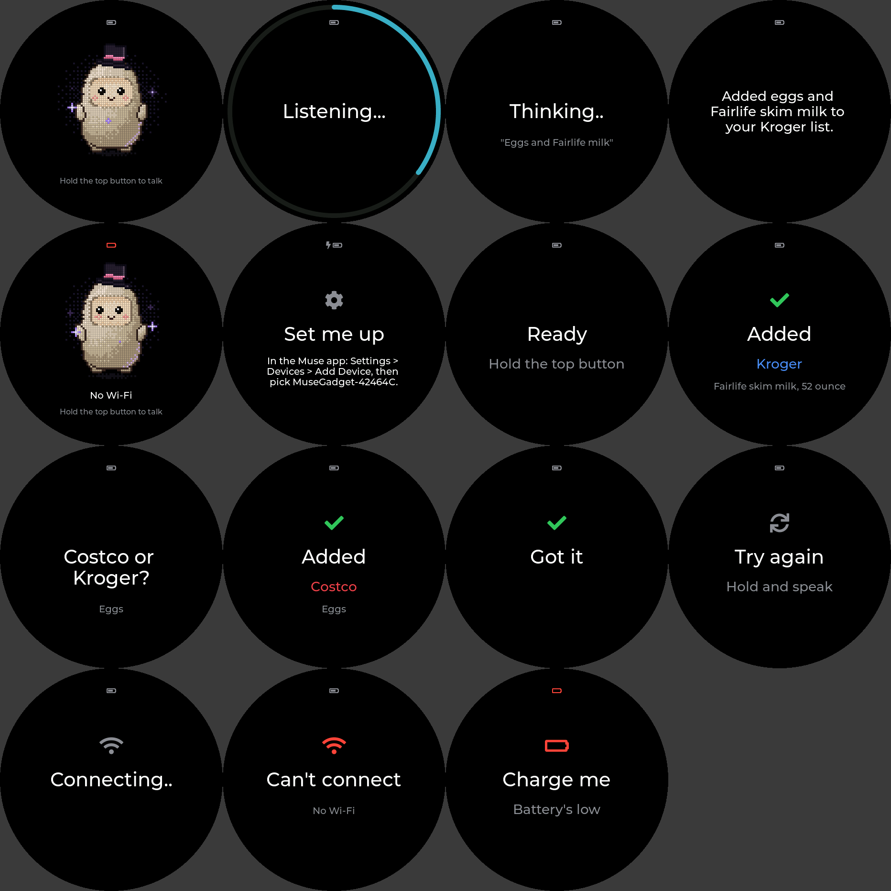

# Firmware: how it's built, and why

## Right now (Oct 21, 2026): Muse voice notes, text replies

The board is flashed and online. For now the button uses the Gadgets SDK's own voice loop, and
the Google speech path below is parked in
[issue #1](https://github.com/MaxTolan/muse-grocery-button/issues/1)
(`CONFIG_GROCERY_GOOGLE_SPEECH`, off):

- **Waiting:** Jollybot in pixel art (the SDK's avatar in the todo display's top hat, ported from
  muse-todo-display), with "Hold the top button to talk" and any status line ("No Wi-Fi").
- **Hold the top button and speak:** "Listening..." with a ring around the rim. On release the
  clip goes to Muse as a voice note, with the text "[fridge-button] Voice note from the grocery
  button on my refrigerator: a grocery item for my Costco or Kroger list. Reply in one short
  sentence." (SDK patch 0005, `CONFIG_MUSE_VOICE_NOTE_TEXT`).
- **Source tag:** every message to Muse starts with `[fridge-button] `, voice notes and outbox
  batches alike, and the tag never reaches the screen, speech or the lists. Convention and rules:
  `03-conversation-design.md`, "Source tag on every message to Muse" (issue #2).
- **Muse transcribes it and replies.** The screen shows "Thinking..." (with what Muse heard, once
  it says), then the reply as text, paged at reading pace. Muse files the item agent-side.
- No speech out, and power is the SDK's own: the screen sleeps after 2 minutes idle, then light
  sleep. Deep sleep comes with the Google path.

The SDK's voice loop caps a note at 15 s, but the AXP2101 cuts power after a 10 s hold of the top
button, so keep presses short.

## The Google speech design (parked, issue #1)

Status: written and builds, but switched off and never run on the board. See "Not yet verified on
the board" at the end before trusting any of it.

### Decisions (owner, Oct 21, 2026)

These answer `05-open-questions.md`.

| Question | Decision |
| --- | --- |
| Gadgets SDK or plain ESP-IDF | **Gadgets SDK** (muse-gadget-sdk, same pin as the todo display). The 1.75C is its reference board: display, codecs, AXP2101, buttons, Wi-Fi setup and the link to Muse all come with it. |
| Transcription | **Google Cloud Speech-to-Text**, called from the device. |
| Text-to-speech | **Google Cloud Text-to-Speech**, called from the device, same API key. |
| Voice-inbox transport | **A chat message to the owner's Muse** over the SDK's Muse session, one message per batch of confirmed items. |
| Wi-Fi provisioning | **The Muse app's pairing** (Settings > Devices > Add Device): it sends Wi-Fi and the device token over BLE. |
| Cloud function hosting | **None.** The device talks to Google directly, so there's no relay to host. |

Why not let Muse do the speech? On the Gadgets path a press is posted into Muse's chat as an audio
voice note. Muse's server transcribes it and the agent replies in text, but the device never sees
the transcript, and Muse doesn't speak gadget replies. Muse would run the whole conversation, every
"Costco" and "that's it" would land in the owner's chat as its own message, and each reply would
wait on the agent. Google speech keeps the script on the device, fast and predictable, and Muse gets
only the confirmed items.

### How it works

```
hold PWR ──► record 16 kHz mono (pre-roll, light noise gate, 8 s cap)
release  ──► Google Speech-to-Text (latest_short, "Costco"/"Kroger" hints)
         ──► the script (docs/03) ──► Google Text-to-Speech ──► speaker
                  │
                  └─ confirmed item ──► submit_item(text, store)
                                          └─ outbox in flash ──► chat message to Muse
                                                                  (removed on Muse's ack)
```

- **The script** (`grocery_script.c`) follows `03-conversation-design.md`: store named → "Added …
  to Kroger. Anything else?"; no store → "Costco or Kroger?", asked once more, then Kroger with
  "I'll put … on the Kroger list."; nothing usable → "I didn't catch that — try again?", then
  "Let's try once more, nice and slow." and sleep; a tap, "that's it", or letting go without
  speaking → "Got it."; 30 s of silence → sleep without a goodbye.
- **Parsing** (`grocery_parse.c`) finds the store (including "Kruger", a common mishearing),
  drops filler ("add", "please", "to the Costco list"), and spots endings ("that's it", "nope").
- **The voice inbox** (`grocery_outbox.c`, `grocery_glue.c`): every confirmed item goes into an
  outbox saved in flash. When Muse is in reach, everything waiting goes as one chat message:

  ```
  [fridge-button] Please put these on my Costco/Kroger grocery lists.
  - Kroger: Fairlife skim milk, 52 ounce
  - Costco: eggs
  ```

  Items leave the outbox only when Muse acknowledges the message (SDK patch 0004 adds that
  acknowledgement), so a dropped connection, a dead battery or deep sleep can't lose one. Before
  sleeping, the button waits up to 20 s for Muse to take what's waiting; anything left goes next
  time. Muse files the items and runs the Kroger $40 check. List management stays agent-side.
- **The screen** (`grocery_ui.c`) is status only: Listening (with a ring showing recording time),
  Thinking, Added + store, the store question, Got it, and a small battery icon. Previews of every
  state (both modes) are in `previews/`.



### Power

- On battery, a session ends in **deep sleep**. The talk button (PWR, which also reaches GPIO3)
  is the wake source, and the press that wakes the button is the one it records: holding PWR
  boots it straight into listening. Wi-Fi is up only during a session.
- On USB power the screen goes dark instead, so the serial console stays usable on the bench.
- Waking from deep sleep is a full boot. The firmware skips the PSRAM test, the app image check
  and the boot animation on that path, and records into memory while Wi-Fi reconnects.
- Below 15% (on battery) the last line of a session adds "Battery's getting low — time for a
  charge." At 5% or less it says the battery's too low and sleeps rather than start an item.
- The speaker amp's enable (GPIO46) is held low through deep sleep.

### Departures from the spec

- **Recording cap is 8 s, not ~15 s.** The talk button is PWR, and the AXP2101 cuts the power
  after PWR is held 10 s. That's its longest setting, so a 15 s hold would turn the board off.
  Grocery items take a few seconds. Moving talk to BOOT would allow 15 s, but means reworking the
  SDK's button handling for this board.
- **"Anything else?" keeps the session open, but each item still takes a hold.** The doc's
  "without re-pressing" reads as "without waking it again". The mic isn't left open hands-free.
- **The SDK's settings screen is still a swipe away** (Wi-Fi, volume). It's the SDK's, not part
  of the grocery UI. Hiding it would mean another SDK patch.

### Setup

1. **ESP-IDF v6.0.1** at `~/esp/esp-idf-v6.0.1` (or set `IDF_EXPORT`), as for the todo display.
2. **Muse SDK token**: put it in `sdk_token.local` (one line, `mgst_…`; the same token as the
   todo display works).
3. **Google Cloud API key**: in a Google Cloud project, enable the *Cloud Speech-to-Text API*
   and the *Cloud Text-to-Speech API*, create an API key, and **restrict it to those two APIs**.
   Put it in `google_api_key.local` (one line). The key is built into the firmware, so restricting
   it limits what a lost device could cost.
4. Set `CONFIG_GROCERY_GOOGLE_SPEECH=y` in `firmware/sdkconfig.grocery`. Then build and flash:
   `tools/fw.sh flash` (USB-C, case closed). `tools/fw.sh monitor` shows the log.
5. Pair: Muse app > Settings > Devices > Add Device, pick `MuseGadget-…` (the screen shows the
   name), and press the top button when asked to confirm. That also sets the Wi-Fi.
6. Optional: tell Muse once that messages starting `[fridge-button]` come from the fridge button
   and carry items for the Costco/Kroger lists, so it files them without asking.

The voice can be changed with `CONFIG_GROCERY_TTS_VOICE` (default `en-US-Neural2-F`).

### Code map

| Path | What |
| --- | --- |
| `components/grocery_button/grocery_script.c` | The conversation script (plain C) |
| `components/grocery_button/grocery_parse.c` | Store, item and "that's it" from a transcript |
| `components/grocery_button/grocery_outbox.c` | The voice inbox's outbox and message |
| `components/grocery_button/grocery_speech_util.c` | Base64, JSON and WAV helpers for Google |
| `components/grocery_button/google_speech.c` | Speech-to-Text / Text-to-Speech over HTTPS |
| `components/grocery_button/grocery_voice.c` | The push-to-talk loop and session timers |
| `components/grocery_button/grocery_ui.c` | The round status screen (LVGL) |
| `components/grocery_button/grocery_mascot.c` | Jollybot in a top hat (from the todo display) |
| `components/grocery_button/grocery_glue.c` | SDK hooks, inbox sending, flash, deep sleep |
| `patches/muse-gadget-sdk/` | Our SDK changes; `tools/fw.sh` applies them to the pinned submodule |
| `firmware/sdkconfig.grocery` | Build settings on top of the SDK's 1.75C overlay |

SDK patches: 0001–0003 are the todo display's (extra config overlays, `muse_ext` app hooks, a
Wi-Fi fix). 0004 lets the app replace the SDK's voice loop and reports Muse's acknowledgement of a
typed message. 0005 adds the text sent with each voice note.

### Tests

- `tools/test.sh`: host tests for the script, parsing, outbox and speech helpers (sanitizers on).
- `tools/preview.sh`: renders every screen state to `docs/previews/`.
- The SDK's own host tests pass with the patches applied
  (`python3 -m unittest discover -s tests` in `third_party/muse-gadget-sdk/esp32`).

### Not yet verified on the board

Everything below needs the 1.75C on the bench:

- Audio: mic gain and the noise-gate thresholds in a real kitchen, speaker volume, and whether
  speech sounds clean through the codec.
- Wake: how much of the first word a cold wake from deep sleep clips, and the time from release to
  the spoken confirmation against the < 5 s budget.
- Google: the API calls themselves (written against the documented REST APIs; never run).
- Deep sleep: GPIO3 wakes the chip, the amp stays quiet, the panel and touch stay asleep, and the
  draw in sleep. No battery-life figures are claimed or implied.
- The Muse inbox: that Muse acknowledges the message and files the items as hoped.
